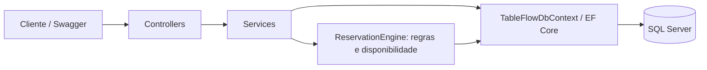

# TableFlow

API de reservas de restaurantes em C# / .NET 10, ASP.NET Core, EF Core e SQL Server. Gerencia mesas por capacidade e horário e impede reservas sobrepostas sob concorrência.

## Funcionalidades e arquitetura

- CRUD de restaurantes e mesas; filtros por cidade, cozinha, restaurante e atividade.
- Criação e atualização de reservas; confirmação e cancelamento idempotentes.
- Busca por status, restaurante, mesa, grupo mínimo e datas, com paginação e ordenação estável por data e id.
- Sugestão de mesa por capacidade e disponibilidade por intervalo.
- Validação de relacionamentos e regras de reserva; erros HTTP com `ProblemDetails`.
- Migrations, seed opcional idempotente, testes unitários e integração em SQL Server real.



Monólito simples: controllers traduzem resultados dos serviços para HTTP; DTOs definem contratos; serviços coordenam persistência; `ReservationEngine` concentra as regras de alocação.

## Regras e concorrência

Restaurante e mesa devem estar ativos; a mesa deve pertencer ao restaurante e acomodar o grupo positivo. A data deve estar no futuro e a duração em minutos deve ser positiva e produzir uma data final válida.

`Pending` e `Confirmed` bloqueiam a mesa; `Cancelled` libera o intervalo. Os intervalos são semiabertos `[início, fim)`: uma reserva pode começar quando a anterior termina. Canceladas não podem ser editadas ou confirmadas. Repetir confirmação de uma confirmada ou cancelamento de uma cancelada retorna o estado atual.

Criação e atualização usam transação SQL Server com `sp_getapplock` exclusivo por mesa antes de consultar conflitos e salvar. Trocar de mesa bloqueia a antiga e a nova por ordem crescente de id. Atualização, confirmação e cancelamento primeiro bloqueiam o id da reserva para evitar decisões com status obsoleto. O lock pertence à transação e é liberado no commit/rollback, inclusive entre instâncias da API. Timeout de lock (10 segundos) e deadlock retornam `409`, permitindo nova tentativa. [Documentação do SQL Server](https://learn.microsoft.com/en-us/sql/relational-databases/system-stored-procedures/sp-getapplock-transact-sql).

A garantia depende de gravações seguirem esse protocolo; SQL manual e outras aplicações que ignorem os locks não ficam protegidos. Execute o seed como operação administrativa sem tráfego concorrente. Não há constraint SQL de exclusão de intervalos.

Excluir restaurante com mesas/reservas ou mesa com reservas (inclusive canceladas) retorna `409`, sem cascata. A API verifica dependências e também traduz violações das FKs conhecidas se uma dependência surgir entre a verificação e a exclusão. Outros erros de banco não são mascarados. Recurso ausente retorna `404`; exclusão válida, `204`.

## Datas e compatibilidade

JSON e query string exigem ISO 8601 com segundos e `Z` ou offset explícito, como `2030-11-01T18:00:00Z` ou `2030-11-01T15:00:00-03:00`. Entradas sem fuso, datas inválidas e datas sem horário retornam `400`. Offsets são normalizados para UTC antes de validar e persistir. Respostas usam UTC com `Z`; comparações futuras usam `DateTime.UtcNow`.

A coluna existente `datetime2` é mantida: armazena UTC sem metadado de fuso e o EF atribui `DateTimeKind.Utc` ao ler. Nenhuma migration altera horários existentes.

**Antes de usar esta versão sobre banco legado:** faça backup e audite a origem/fuso de `ReservationDate`. Valores comprovadamente UTC permanecem intactos. Valores locais precisam de conversão única, separada e revisada, com o fuso de origem e tratamento das ambiguidades de horário de verão. Valores de origem desconhecida exigem revisão manual: `datetime2` sozinho não recupera o instante original. Não aponte esta versão para esse banco até concluir a auditoria: a leitura assume valores já em UTC. Os testes verificam preservação literal de uma linha legada auditada e rejeição de novas entradas ambíguas.

## Executar localmente (sem Docker)

Pré-requisitos: SDK .NET 10 compatível com `global.json`, SQL Server local iniciado (Developer/Express ou LocalDB no Windows) e conta com permissão de criar/alterar o banco de demonstração. Não é necessário VS Code nem ferramenta global `dotnet-ef`.

Na raiz, em PowerShell:

```powershell
dotnet restore
dotnet build --no-restore
$env:ConnectionStrings__TableFlowDatabase='Server=localhost;Database=TableFlowDb;Integrated Security=True;Encrypt=True;TrustServerCertificate=True'
dotnet run --project src/TableFlow.Api -- --migrate
dotnet run --project src/TableFlow.Api -- --seed  # opcional
dotnet run --project src/TableFlow.Api --launch-profile http
```

Para Express, substitua `localhost` por `.\SQLEXPRESS`; para LocalDB, por `(localdb)\MSSQLLocalDB`. Se usar autenticação SQL, forneça credenciais por variável de ambiente ou user-secrets sem versioná-las. `.env.example` é referência: o .NET não o carrega automaticamente. `TrustServerCertificate=True` é uma conveniência local para certificado próprio.

API: `http://localhost:5172`; Swagger: `http://localhost:5172/docs`. Para HTTPS, execute `dotnet dev-certs https --trust` e use `--launch-profile https`, com Swagger em `https://localhost:7095/docs`. A UI é habilitada no ambiente Development.

`--migrate` aplica todas as migrations e encerra. `--seed` executa `scripts/seed-large.sql` e encerra. Pode combinar `-- --migrate --seed`. A inicialização normal nunca altera o esquema ou carrega dados. O script também pode ser executado por SSMS ou `sqlcmd` no banco configurado.

O seed adiciona 10 restaurantes, 80 mesas e 480 reservas com 90 minutos, datas UTC e status variados. Identifica seus registros por nomes de demonstração e número da mesa; reexecuções não duplicam registros nem reescrevem suas datas. As datas são relativas à primeira execução; reservas antigas não são renovadas. Há um restaurante inativo para demonstração. Reserve os prefixos `TF Demo -` e `Carga TF ` para o seed.

## Demonstração HTTP

Exemplos para banco novo; use os ids retornados se já houver dados. Escolha uma data futura com fuso explícito.

```http
POST /restaurants
Content-Type: application/json

{"name":"Bistro Central","cuisineType":"Brasileira","city":"São Paulo","isActive":true}

HTTP/1.1 201 Created
{"id":1,"name":"Bistro Central","cuisineType":"Brasileira","city":"São Paulo","isActive":true}
```

```http
POST /tables
Content-Type: application/json

{"restaurantId":1,"number":1,"capacity":4,"isActive":true}

HTTP/1.1 201 Created
{"id":1,"restaurantId":1,"number":1,"capacity":4,"isActive":true}
```

```http
GET /reservations/availability?restaurantId=1&partySize=4&reservationDate=2030-11-01T18:00:00Z&durationMinutes=90

HTTP/1.1 200 OK
{"restaurantId":1,"partySize":4,"reservationDate":"2030-11-01T18:00:00.0000000Z","durationMinutes":90,"reservationEnd":"2030-11-01T19:30:00.0000000Z","candidateTables":[{"id":1,"number":1,"capacity":4}],"availableTables":[{"id":1,"number":1,"capacity":4}]}
```

Disponibilidade representa o estado observado durante a consulta, sem bloquear ou reservar mesas. Pode mudar antes do POST; apenas a criação concluída confirma a alocação. Para offsets positivos em URLs, codifique `+` como `%2B`.

```http
POST /reservations
Content-Type: application/json

{"restaurantId":1,"tableId":1,"customerName":"Ana Silva","reservationDate":"2030-11-01T18:00:00Z","durationMinutes":90,"partySize":4}

HTTP/1.1 201 Created
{"id":1,"restaurantId":1,"tableId":1,"customerName":"Ana Silva","reservationDate":"2030-11-01T18:00:00.0000000Z","durationMinutes":90,"partySize":4,"status":"Pending"}
```

Repetir o POST para a mesma mesa e intervalo retorna:

```http
HTTP/1.1 409 Conflict
Content-Type: application/problem+json

{"type":"https://tools.ietf.org/html/rfc9110#section-15.5.10","title":"Reservation conflict","status":409,"detail":"The selected table is not available for the requested time period."}
```

`ProblemDetails` pode incluir `traceId`. `PUT /reservations/1/confirm` confirma; `PUT /reservations/1/cancel` cancela (sem corpo). Ambos retornam `200` com a reserva. Após cancelar, repita a disponibilidade: a mesa estará livre se não houver outra reserva bloqueadora. `PUT /reservations/1` aceita os mesmos campos do POST para editar reserva ativa.

Busca: `GET /reservations/search?restaurantId=1&status=Pending&pageNumber=1&pageSize=20&descending=false`. Filtros adicionais: `tableId`, `minimumPartySize`, `fromDate` e `toDate` (limites inclusivos, datas com fuso). Resposta: `items`, `pageNumber`, `pageSize`, `totalCount`, `totalPages`, `hasNextPage`. `pageSize` aceita 1 a 100.

Permanecem as listas geral e por restaurante/mesa/status, `/reservations/upcoming`, `/reservations/upcoming/pending`, `/reservations/upcoming/confirmed` e `/reservations/suggested-table?restaurantId=1&partySize=4` (sugestão por capacidade sem horário).

## Testes e CI

Somente testes unitários, sem banco (xUnit, Moq e MockQueryable.Moq):

```powershell
dotnet test --configuration Release --filter 'Category!=Integration'
```

Os arquivos `tests/TableFlow.Tests/Unit/RestaurantServiceTests.cs`, `TableServiceTests.cs`, `ReservationServiceTests.cs` e `ReservationEngineTests.cs` usam mocks de `DbContext`/`DbSet`, motor de validação e coordenação transacional. Cobrem decisões, alterações de estado e chamadas de gravação; não comprovam tradução SQL, constraints ou concorrência real. O filtro `Category=Unit` seleciona apenas essas quatro classes. O filtro acima inclui também os testes de datas. A configuração Release permite executar os testes enquanto a API está aberta em Debug.

`IReservationWriteSession` concentra o início da transação, locks e releitura da reserva para que o `ReservationService` possa ter essas dependências simuladas. A implementação real mantém o protocolo SQL Server existente.

Suíte completa com SQL Server real:

```powershell
$env:TABLEFLOW_TEST_SQLSERVER='Server=localhost;Database=master;Integrated Security=True;Encrypt=True;TrustServerCertificate=True'
dotnet test
```

A conta precisa criar e excluir bancos. A suíte cria um banco exclusivo `TableFlowTests_<guid>`, aplica migrations e exclui apenas esse banco ao terminar. Não usa InMemory/SQLite nem apaga o banco da aplicação. Sem a variável, a integração aparece explicitamente como ignorada; isso não comprova validação SQL. Com a variável definida, conexão ou migrations inválidas falham os testes.

Integração cobre capacidade, atividade, relacionamentos, duração, datas, intervalos consecutivos/sobrepostos, criação/atualização da própria reserva, mudança de mesa concorrente, status concorrentes, disponibilidade, busca/paginação, exclusões e corrida de FK, data legada auditada, migrations e reexecução do seed. Requisições HTTP concorrentes usam escopos/conexões separados e verificam respostas e estado persistido.

O workflow `.github/workflows/ci.yml` executa restore, build Release e todos os testes em push e pull request, com SQL Server LocalDB no runner Windows e resultados TRX como artefato. Falhas nos testes falham o job. O LocalDB consta na [imagem oficial do runner](https://github.com/actions/runner-images/blob/main/images/windows/Windows2025-Readme.md). Nenhum container é necessário.

## Limitações

Projeto de portfólio sem autenticação, integrações externas, observabilidade de produção ou infraestrutura de nuvem. A disponibilidade é consultiva. Mudanças administrativas simultâneas em capacidade/atividade das mesas não usam o protocolo de reserva. Cancelamento mantém o histórico; exclusões preservam as FKs Restrict. Migrations anteriores são preservadas e a política UTC não altera o esquema. Não há push, deploy ou criação de tag no fluxo local.
