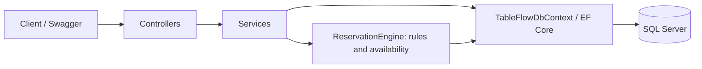

# TableFlow

A restaurant reservation API built with C# / .NET 10, ASP.NET Core, EF Core, and SQL Server. It assigns tables by capacity and time and prevents overlapping reservations under concurrent requests.

## Features and Architecture

- Restaurant and table CRUD; filters by city, cuisine, restaurant, and active status.
- Reservation creation and updates; idempotent confirmation and cancellation.
- Search by status, restaurant, table, minimum party size, and date range, with pagination and stable ordering by date and ID.
- Table suggestions by capacity and availability queries for a time interval.
- Relationship and reservation validation; HTTP errors using `ProblemDetails`.
- Migrations, an optional idempotent seed, unit tests, and integration tests against real SQL Server.



A simple monolith: controllers translate service results into HTTP responses, DTOs define contracts, services coordinate persistence, and `ReservationEngine` centralizes table allocation rules.

## Business Rules and Concurrency

The restaurant and table must be active. The table must belong to the requested restaurant and accommodate a positive party size. The reservation must start in the future, and its duration in minutes must be positive and produce a valid end time.

`Pending` and `Confirmed` block the table; `Cancelled` releases the interval. Intervals are half-open `[start, end)`: a reservation may start exactly when the previous one ends. Cancelled reservations cannot be updated or confirmed. Confirming an already confirmed reservation or cancelling an already cancelled reservation returns its current state.

Creation and updates use a SQL Server transaction with an exclusive `sp_getapplock` per table before checking conflicts and saving. Moving a reservation locks both its old and new tables in ascending ID order. Updates, confirmation, and cancellation first lock the reservation ID and reload its persisted state to avoid decisions based on stale status. Locks belong to the transaction and release on commit/rollback, including across API instances. Lock timeouts (10 seconds) and deadlocks return `409`, allowing the caller to retry. See the [SQL Server documentation](https://learn.microsoft.com/en-us/sql/relational-databases/system-stored-procedures/sp-getapplock-transact-sql).

This guarantee depends on writes following the locking protocol. Manual SQL and other applications that bypass these locks are not protected. Run the seed as an administrative operation without concurrent application traffic. There is no SQL interval-exclusion constraint.

Deleting a restaurant with tables/reservations or a table with reservations, including cancelled reservations, returns `409` without cascading deletes. The API checks dependencies and also translates violations of known foreign keys if a dependency appears between the check and deletion. Unrelated database errors are not masked. Missing resources return `404`; successful deletion returns `204`.

A table with any linked reservation, including a cancelled one, cannot move to another restaurant: `PUT /tables/{id}` returns `409` with `ProblemDetails`. Tables without reservations can move to an existing restaurant if their number is unique there. Number, capacity, and active status remain editable within the same restaurant. Table updates use a transaction and the same reservation lock to protect the dependency check against concurrent reservation creation. Previously inconsistent records are not automatically repaired.

A capacity reduction must still accommodate every `Pending` or `Confirmed` reservation on that table whose end time is later than the current UTC time. This includes reservations already in progress, not just future starts. Cancelled reservations and reservations ending at or before the check time are ignored. If any relevant party size exceeds the requested capacity, the update returns `409` with `ProblemDetails` (`Table capacity conflict`) before changing or saving any table field. Capacity increases, unchanged capacity, and reductions that still fit all relevant parties remain allowed. The check runs inside the existing transaction and table lock, shared with reservation writes.

## Dates and Compatibility

JSON and query-string dates require ISO 8601 with seconds and an explicit `Z` or offset, such as `2030-11-01T18:00:00Z` or `2030-11-01T15:00:00-03:00`. Dates without a time zone, invalid dates, and date-only values return `400`. Offsets normalize to UTC before validation and persistence. Responses use UTC with `Z`; future-date comparisons use `DateTime.UtcNow`.

The existing `datetime2` column is retained. It stores UTC values without time-zone metadata, and EF assigns `DateTimeKind.Utc` on reads. No migration shifts existing timestamps.

**Before using this version with a legacy database:** back up the data and audit the original time zone of `ReservationDate`. Values confirmed as UTC remain unchanged. Local timestamps need a separate, reviewed, one-time conversion using the source time zone and an explicit policy for daylight-saving ambiguities. Unknown-origin timestamps require manual review: `datetime2` alone cannot recover the original instant. Do not point this version at that database until the audit is complete, because reads assume values already represent UTC. Tests verify literal preservation of an audited legacy UTC row and rejection of new ambiguous inputs.

## Running Locally Without Docker

Prerequisites: a .NET 10 SDK compatible with `global.json`, a running local SQL Server instance (Developer/Express or LocalDB on Windows), and an account allowed to create/alter the demonstration database. VS Code and a global `dotnet-ef` installation are not required.

From the repository root, in PowerShell:

```powershell
dotnet restore
dotnet build --no-restore
$env:ConnectionStrings__TableFlowDatabase='Server=localhost;Database=TableFlowDb;Integrated Security=True;Encrypt=True;TrustServerCertificate=True'
dotnet run --project src/TableFlow.Api -- --migrate
dotnet run --project src/TableFlow.Api -- --seed  # optional
dotnet run --project src/TableFlow.Api --launch-profile http
```

For Express, replace `localhost` with `.\SQLEXPRESS`; for LocalDB, use `(localdb)\MSSQLLocalDB`. When using SQL authentication, provide credentials through environment variables or user-secrets without committing them. `.env.example` is a reference; .NET does not load it automatically. `TrustServerCertificate=True` is a local convenience for a self-signed certificate.

API: `http://localhost:5172`; Swagger: `http://localhost:5172/docs`. For HTTPS, run `dotnet dev-certs https --trust` and use `--launch-profile https`, with Swagger at `https://localhost:7095/docs`. The UI is enabled in the Development environment.

`--migrate` applies all migrations and exits. `--seed` runs `scripts/seed-large.sql` and exits. They can be combined as `-- --migrate --seed`. Normal startup never applies migrations or loads data. The script can also run through SSMS or `sqlcmd` against the configured database.

The seed adds 10 restaurants, 80 tables, and 480 reservations with 90-minute durations, UTC dates, and varied statuses. It identifies its records through demonstration names and table numbers. Reruns neither duplicate records nor rewrite their dates. Dates are relative to the initial insertion; old demonstration reservations are not refreshed. One restaurant is inactive for demonstration purposes. Reserve the `TF Demo -` and `Carga TF` prefixes for seed data.

## HTTP Demonstration

These examples assume a new database. Use the returned IDs if data already exists, and choose a future date with an explicit time zone. Sample names, cuisine, and city values are ordinary application data.

```http
POST /restaurants
Content-Type: application/json

{"name":"Bistro Central","cuisineType":"Brasileira","city":"São Paulo","isActive":true}

HTTP/1.1 201 Created
{"id":1,"name":"Bistro Central","cuisineType":"Brasileira","city":"São Paulo","isActive":true}
```

```http
POST /tables
Content-Type: application/json

{"restaurantId":1,"number":1,"capacity":4,"isActive":true}

HTTP/1.1 201 Created
{"id":1,"restaurantId":1,"number":1,"capacity":4,"isActive":true}
```

```http
GET /reservations/availability?restaurantId=1&partySize=4&reservationDate=2030-11-01T18:00:00Z&durationMinutes=90

HTTP/1.1 200 OK
{"restaurantId":1,"partySize":4,"reservationDate":"2030-11-01T18:00:00.0000000Z","durationMinutes":90,"reservationEnd":"2030-11-01T19:30:00.0000000Z","candidateTables":[{"id":1,"number":1,"capacity":4}],"availableTables":[{"id":1,"number":1,"capacity":4}]}
```

Availability reports the state observed during the query; it does not lock or allocate tables. It may change before the POST completes. Only a completed creation allocates the table. Encode `+` as `%2B` when using positive offsets in URLs.

```http
POST /reservations
Content-Type: application/json

{"restaurantId":1,"tableId":1,"customerName":"Ana Silva","reservationDate":"2030-11-01T18:00:00Z","durationMinutes":90,"partySize":4}

HTTP/1.1 201 Created
{"id":1,"restaurantId":1,"tableId":1,"customerName":"Ana Silva","reservationDate":"2030-11-01T18:00:00.0000000Z","durationMinutes":90,"partySize":4,"status":"Pending"}
```

Repeating the POST for the same table and interval returns:

```http
HTTP/1.1 409 Conflict
Content-Type: application/problem+json

{"type":"https://tools.ietf.org/html/rfc9110#section-15.5.10","title":"Reservation conflict","status":409,"detail":"The selected table is not available for the requested time period."}
```

`ProblemDetails` may include `traceId`. `PUT /reservations/1/confirm` confirms a reservation; `PUT /reservations/1/cancel` cancels it, both without a request body. Both return `200` with the reservation. After cancellation, query availability again: the table will be free if no other reservation blocks it. `PUT /reservations/1` accepts the same fields as POST to update an active reservation.

Search: `GET /reservations/search?restaurantId=1&status=Pending&pageNumber=1&pageSize=20&descending=false`. Additional filters are `tableId`, `minimumPartySize`, `fromDate`, and `toDate` (inclusive boundaries, dates with time zones). The response contains `items`, `pageNumber`, `pageSize`, `totalCount`, `totalPages`, and `hasNextPage`. `pageSize` accepts 1 through 100.

The general list and restaurant/table/status lists remain available, along with `/reservations/upcoming`, `/reservations/upcoming/pending`, `/reservations/upcoming/confirmed`, and `/reservations/suggested-table?restaurantId=1&partySize=4`. The last endpoint suggests a table by capacity without considering a reservation time.

## Tests and CI

Run unit tests without a database (xUnit, Moq, and MockQueryable.Moq):

```powershell
dotnet test --configuration Release --filter 'Category!=Integration'
```

The files in `tests/TableFlow.Tests/Unit/` include `RestaurantServiceTests.cs`, `TableServiceTests.cs`, `ReservationServiceTests.cs`, and `ReservationEngineTests.cs`. They mock `DbContext`/`DbSet`, validation, and transaction coordination. They verify decisions, state changes, and persistence calls; they do not establish SQL translation, constraints, or real concurrency guarantees. `TablesControllerTests` verifies the blocked-transfer and insufficient-capacity `409` responses using mocks. The `Category=Unit` filter selects these five classes. The filter above also includes UTC parsing tests. Release allows tests to run while the API is open in Debug.

`IReservationWriteSession` exposes transaction creation, locks, and reservation reloading so `ReservationService` can use mocked dependencies. `TableService` also uses it to coordinate table updates with reservation writes. The real implementation retains the SQL Server locking protocol.

Run the full suite with real SQL Server:

```powershell
$env:TABLEFLOW_TEST_SQLSERVER='Server=localhost;Database=master;Integrated Security=True;Encrypt=True;TrustServerCertificate=True'
dotnet test --configuration Release
```

The test account must be allowed to create and drop databases. The suite creates a uniquely named `TableFlowTests_<guid>` database, applies migrations, and drops only that database when finished. It does not use InMemory/SQLite or delete the application database. Without the environment variable, integration tests are explicitly skipped; that is not evidence of SQL validation. With the variable set, invalid connections or migrations fail the tests.

Integration coverage includes capacity, active status, relationships, duration, dates, adjacent/overlapping intervals, creation and self-updates, concurrent reservation moves, concurrent status changes, availability, search/pagination, deletion and foreign-key races, audited legacy UTC data, migrations, and seed reruns. Concurrent HTTP requests use separate scopes/connections and verify responses and persisted state.

`TableCapacityIntegrationTests` verifies reductions against future and ongoing active reservations, ignored cancelled/ended reservations, exact-fit reductions, increases, unchanged capacity, reservations on other tables, rejection without persisted table changes, and concurrent reservation creation versus capacity reduction. The latest local Release run passed all **136 tests**: **120 unit cases** (including UTC parsing) and **16 SQL Server integration cases**, with no failures or skips.

The `.github/workflows/ci.yml` workflow runs restore, a Release build, and all tests on push and pull request, using SQL Server LocalDB on a Windows runner and uploading TRX results. Failed tests fail the job. LocalDB is included in the [official runner image](https://github.com/actions/runner-images/blob/main/images/windows/Windows2025-Readme.md). No container is required.
